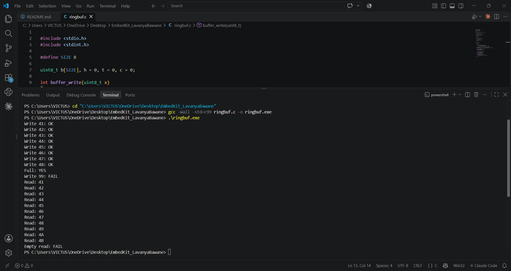

# Ring Buffer Implementation in C

## Overview
This project implements a simple ring buffer (circular buffer) using the C programming language.

A ring buffer stores data in a fixed-size array. When the end of the array is reached, the next position wraps around to the beginning.

## Features
- Fixed buffer size of 8 bytes
- Write data to the buffer
- Read data from the buffer
- Check for a full buffer
- Prevent writing when the buffer is full
- Prevent reading when the buffer is empty
- Reuse buffer space after reading

## Implementation
The program uses:
- An array to store data
- A write index to track where the next byte is stored
- A read index to track where the next byte is retrieved
- A counter to track the number of bytes in the buffer

## Compile and Run

Compile using GCC:

```bash
gcc -Wall -std=c99 ringbuf.c -o ringbuf.exe
```

Run on Windows PowerShell:

```powershell
.\ringbuf.exe
```

## Language
C


## Output


